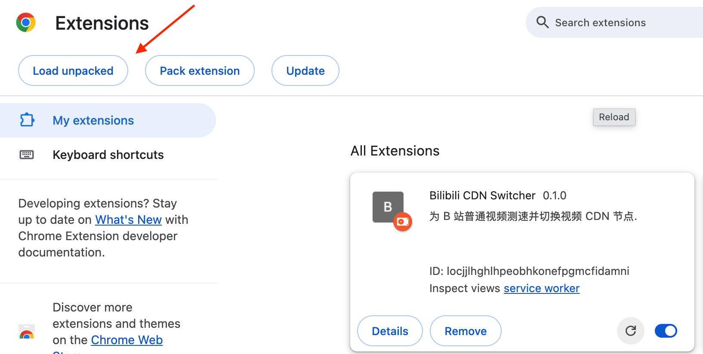
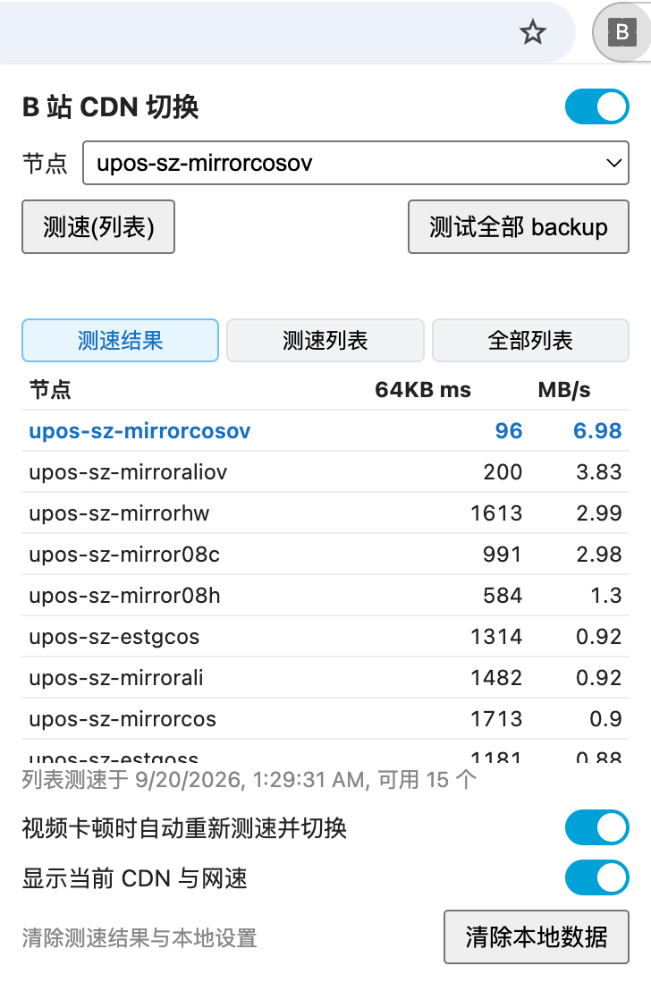
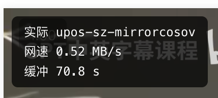

# Bilibili CDN Switcher

为 B 站普通视频(`www.bilibili.com/video/*`)测速并切换视频 CDN 节点的 Chrome 扩展.

## 安装

1. 打开 `chrome://extensions`, 开启右上角「开发者模式」
2. 点「加载已解压的扩展程序」(Load unpacked), 选择本仓库的 `extension/` 目录
3. 更新代码后, 在扩展卡片上点刷新按钮(Reload)



## 使用

在视频页播放视频后, 点击工具栏上的扩展图标:



- **启用开关**: 第一次启用会先测速, 自动选最快的节点
- **节点下拉框 / 点击结果表中的一行**: 手动切换节点
- **测速(列表)**: 测试 `cdn_list.json` 中的节点(以及测 backup 时发现的额外可用节点)
- **测试全部 backup**: 测试 `cdn_backup.json` 中的全部节点, 可用的保存在本地
- **卡顿自动切换**: 播放中缓冲耗尽持续 3 秒时, 重新测速并切换到最快节点
- **显示当前 CDN 与网速**: 在播放器左上角显示实际节点, 网速和缓冲



浮层各行的含义: `实际` 是分片真正来自的节点(取自实际网络请求), 切换生效与否看这一行;
切换后分片还来自旧节点时会多出 `目标` 一行; 重定向生效时会多出 `默认` 一行, 即 B 站原本签发的节点.

切换只影响之后的分片请求, 已在下载的分片仍来自原节点.

## 原理

- 同一个签名 URL 在各 `upos-*` / `cn-*` `.bilivideo.com` 节点上通用, 只替换域名即可
- 扩展用 `declarativeNetRequest` 在网络层把视频分片请求(`*.bilivideo.com/upgcxcode/*`)重定向到选定节点, 播放器 Worker 里的请求同样生效
- 测速在页面内进行, 使用当前视频的签名 URL; 测速请求带 `cdnsw_probe` 标记, 不被重定向

## 节点列表

| 文件 | 内容 |
|---|---|
| `cdn_list.json` | 最近一次检测可用的节点, 扩展从 GitHub 读取 |
| `cdn_backup.json` | 所有发现过的节点及最近检测状态, 只增不减 |

GitHub Actions 每周六, 周日 UTC 00:00 运行 `tools/update_cdn.py` 更新两个列表. 本地同样可以运行(只需 Python 3, 无第三方依赖):

```bash
python3 tools/update_cdn.py             # 检测, 测速并写回两个列表
python3 tools/update_cdn.py --no-write  # 只检测和打印
```

候选节点来源: backup 全部节点 + [ccb](https://github.com/Kanda-Akihito-Kun/ccb) 节点列表 + crt.sh 证书日志 + `upos-*` 命名枚举.
注意 Actions 运行在海外, 只对国内开放的节点会被判为不可用; 用户可在扩展中「测试全部 backup」按自己的网络重新筛选.
